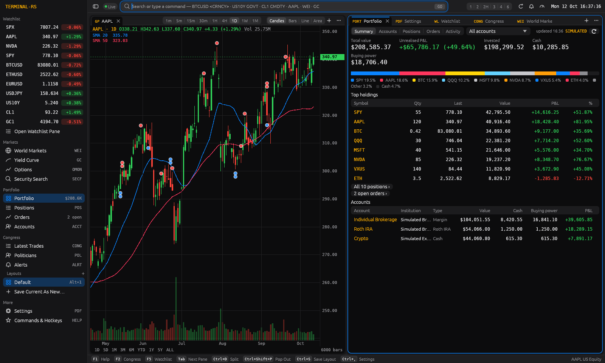
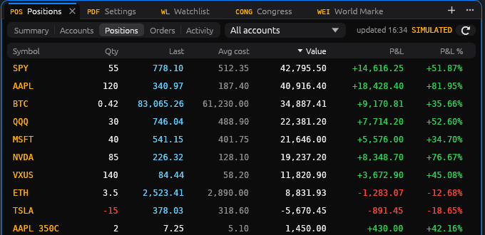

# terminal-rs

A fast, keyboard-driven market terminal in pure Rust: TradingView-class GPU charting with a
Bloomberg Terminal look (dense tiled panes, monospace numbers, a command line like `AAPL <GO>`)
across **stocks, ETFs, indices, FX, crypto, US Treasuries, futures/commodities and options**,
plus **congressional trade tracking from House Clerk disclosures and [Bargo Senate data](https://www.bargo.ai/free-apis/congress)** and **your own brokerage accounts through [SnapTrade](https://snaptrade.com)**
(read-only by default, with opt-in order entry). Native compact UI, themes from Bloomberg amber
to Solarized, and a fully dockable
workspace with saved layouts.


> **Built from reverse-engineering research.** Chart UX was studied behaviourally on
> tradingview.com with [REA](https://github.com/morluto/rea) in website mode (passive captures of
> the public, logged-out chart page), then given a Bloomberg Terminal look. Findings, evidence IDs
> and their design implications are in [`docs/analysis/`](docs/analysis/README.md). Only behaviour
> was studied: no TradingView or Bloomberg code, scripts, icons, fonts or other assets are used or
> included here. The disclosure parsers were likewise built by examining the public Senate eFD and
> House Clerk sites and their filings.

## Screenshots

| | |
|---|---|
|  |  |
| **Bloomberg theme** — `NVDA`, `POL PELOSI`: party-coloured B/S markers and a politician profile with estimated return, hit rate and disclosure lag | **Options** — `AAPL OMON`: every expiry, calls and puts by strike, IV and greeks, spot line |
|  |  |
| **Terminal Light** — the latest STOCK Act filings with party, chamber, owner and amount filters | **Docking** (Nord theme, sidebar on the right) — drag a tab onto the compass to tab or split |
|  |   |
| **Theme editor** — edit any colour, font or density live; save, duplicate, import/export TOML or JSON | **Theme gallery** and the **marker hover card** (politician, amount, traded/filed, disclosure lag) |
|  |  |
| **Portfolio** — `PORT`: value, unrealised P&L, cash and buying power, allocation, top holdings, accounts (simulated sample shown) | **Positions** — `POS`: live terminal quotes (cyan) reprice holdings; click a row to chart it |

Screenshots are from the Linux build under Xvfb with live data (October 2026); on macOS the same UI
gets the native title bar with traffic lights, window vibrancy behind the sidebar and SF fonts.

## Features

- **Scanner** (`SCAN`, `NEW SCAN`, `SPLIT SCAN`) — scan your watchlist (up to 200 symbols) or,
  with a bulk data source, the whole market: **All US stocks** (about 5,600), **Nasdaq** or
  **NYSE** listings from Nasdaq Trader's daily symbol directory, without ETFs, test issues,
  warrants, units, rights, preferreds, notes or ADRs. Conditions compare price, volume,
  previous-bar change, SMA and EMA (of close or volume), RSI and ATR against values or each other,
  with `>`, `<`, `>=`, `<=` and crosses; any operand can look **N bars back** ("yesterday's RSI")
  and the right side can be **multiplied** (`Volume >= EMA(50, Volume) × 2.5`). Combine with
  All/Any, save named scans, restore them with layouts, and click results to open linked charts.
  Built-in presets: **Momentum Ignition** (the first day RSI(14) reaches 70 above a 4-day EMA)
  and **Volume Thrust** (RSI(14) ≥ 69.8 on 2.5× the 50-day volume EMA with a true range over
  $0.50). Market-wide scans keep their own bar store (`scan_bars.sqlite3`, with source and
  fetch time per symbol): compatible fresh snapshots are reused; stale snapshots and larger
  lookbacks fetch full history (several minutes through Questrade), with progress and **Stop**. Results show
  bar timestamps, missing-data errors and explicit sample-data labels; a failed fetch is
  "unavailable", never a silent fallback. Evaluation is local; it does not connect to TC2000.
  Research and scope: [EasyScan analysis](docs/analysis/tc2000-easyscan.md).

- **Multi-asset with Bloomberg-style market keys** — `AAPL <EQUITY>`, `SPY <EQUITY>`,
  `SPX <INDEX>`, `BTCUSD <CRNCY>`, `EURUSD <CRNCY>`, `US10Y <GOVT>`, `CL1 <CMDTY>` (keys display
  as `AAPL US Equity`, `BTCUSD Curncy`, `US10Y Govt`, `CL1 Comdty`). The yellow key is optional for
  known tickers. A built-in catalog covers ~120 instruments (regional indices, equity index futures,
  energy/metals/grains, the full Treasury curve, majors and crosses, top crypto, popular ETFs and
  large caps); anything else resolves by convention.
- **Command line and search** — `<SECURITY> [<FUNCTION>] <GO>` (Enter is `<GO>`); typing anywhere
  starts a command, with a live interpretation underneath (`5` → "Interval 5 minutes") and symbol
  matches across all asset classes (catalog instantly, plus Yahoo search after a short pause);
  ↑/↓, Tab, Enter; history with ↑/↓. `SECF gold cmdty` opens a full search panel.
- **Charts** — GPU-rendered candles, OHLC bars, line and area; 1m, 5m, 15m, 30m, 1H, 4H, 1D, 1W,
  1M plus quick ranges (1D … ALL); volume; 151 indicators; `CMP <SYM>` compare on a % change, shared price or own left axis; log scale;
  crosshair with OHLC legend; smooth pan and zoom over a million bars. Live crypto bars from the
  Binance websocket (Coinbase fallback).
- **Indicators** — 151 built-in studies: 23 moving averages (SMA, EMA, WMA, Hull, DEMA/TEMA, KAMA,
  ALMA, T3, McGinley, VIDYA, FRAMA, MAMA/FAMA, Ehlers filters, GMMA…), 8 bands and channels
  (Bollinger, Keltner, Donchian, STARC, standard-error and VWAP bands…), 43 momentum oscillators
  (RSI, MACD, Stochastic, StochRSI, CCI, Williams %R, TSI, KST, Fisher, Schaff, QQE, WaveTrend,
  Connors RSI…), 22 trend tools (ADX/DMI, Aroon, Vortex, Parabolic SAR, SuperTrend, Ichimoku,
  Alligator, ZigZag, fractals, Chandelier and Chande Kroll stops…), 16 volatility measures (ATR,
  close-to-close and Parkinson, Garman-Klass, Rogers-Satchell and Yang-Zhang estimators, Ulcer,
  Mass index, squeeze momentum…), 23 volume studies (OBV, A/D, CMF, MFI, Klinger, NVI/PVI, VZO…),
  11 rolling statistics and five pivot-point families. Type a code with optional parameters
  (`RSI`, `SMA 200`, `BB 20 2.5`), browse and search with `IND`, or right-click the chart.
  Open **Indicators…** on the chart to add multiple independent instances, edit parameters,
  hide plots, choose colors, group plots in resizable panes, and select shared, independent or
  fixed scales. SMA/EMA/WMA/HMA/RMA, Bollinger, RSI and MACD accept selected price/volume fields
  or another indicator's named output (for example EMA of RSI). Hidden studies still supply
  data; cycles are rejected. Up to six additional panes render. Workspace layouts save the
  complete setup and migrate older indicator labels. Calculation options include plain/Wilder RSI,
  selectable ATR/MACD/Bollinger averages, bandwidth units and historical/visual offsets. Named
  local templates restore or merge study setups. See the [chart study guide](docs/chart-studies.md).
  Each output supports its own visibility, color, stroke and plot type; multi-output studies
  can fill between bands. Charts optionally synchronize cursors/date ranges within color
  link groups, preserve historical dates on interval changes, and offer display zones,
  US session filters and periodic history refresh. Larger study timeframes use completed
  periods derived from loaded bars. The `PCF` study plots a documented expression subset.
  See the [review checklist and remaining limits](docs/chart-review.md).
- **Drawings** — trendline (Alt+T), horizontal (Alt+H), vertical (Alt+V) and fib retracement
  (Alt+F), stored in (time, price) so they survive zoom and timeframe changes; magnet (Alt+M) snaps
  to OHLC; click to select, drag anchors or the body to edit, Del to remove. Drawings belong to
  their symbol, with an optional all-symbol scope; color, width and trendline extensions are
  editable. Ctrl/Cmd+Z and Ctrl/Cmd+Shift+Z undo and redo drawing edits.
  The Draw menu and command palette also offer `MEASURE` (price, %, bars and elapsed time),
  `RECT` / `ZONE`, directional `RAY`, three-point `CHANNEL` and multiline `NOTE`.
  See [drawing tools and layout compatibility](docs/chart-drawing-tools.md).
- **Chart agent** (`AGENT`, `NEW AGENT`) — a dockable conversation through your local Codex CLI
  and ChatGPT account, with chart-reading tools and controlled chart edits. The pane shows tool
  activity and edit results; chart analysis uses loaded bars, not a screenshot's approximate prices.
  - **Levels v2** separates major/minor swings, forms support/resistance zones no wider than
    **0.6 ATR**, reports swing and respected-close touches, and marks `recommended` zones (in-play,
    nearest major on each side, then score). Trendlines need **at least three touches**; broken
    lines stay out of active results and are available separately as historical lines.
  - Drawings made with `analysis_ref` use the analysis's **exact time/price coordinates**, not
    rounded prices from the reply. Replacement is per kind, symbol and timeframe: new agent zones
    replace its own zones, not its lines or your drawings. Manual edits transfer ownership to you.
    Analysis drawing caps are **six zones and two lines per role**; hidden drawings produce a notice
    rather than silently enabling them. Venue-qualified crypto aliases resolve as the same instrument
    for analysis references and drawings; distinct instruments remain distinct.
  - `read_news` and `read_filings` read **local stored data only**, without fetching news, filings
    or full articles. Headlines and filing metadata are **untrusted data**, never instructions to
    the agent. News reads cover at most 168 hours / 50 stories; filing reads at most 90 days /
    50 filings. The News pane's **Copy digest** uses the same deterministic local digest builder.
- **Company profile** (`AAPL DES`) — exchange, industry, market cap and website from Finnhub; needs your Finnhub key, cached locally
- **Options** (`AAPL OMON`, ⌘⇧O) — full chains from Yahoo for US equities, ETFs and indices
  (SPX via ^SPX): every expiration, calls and puts by strike with bid/ask/last, change, volume,
  open interest and IV, plus Black-Scholes greeks (Δ, Γ, Θ/day, vega) from each contract's IV, the
  dividend yield and the 3-month T-bill rate; in-the-money shading, spot line, ±10/±20/all
  strikes; offline mode shows a flagged simulated chain.
- **Markets** — `WEI` world markets (Americas/EMEA/Asia-Pacific indices, futures, Treasuries, FX,
  crypto and commodities with sparklines), `GC` US Treasury yield curve (now vs 1M and 1Y ago,
  2s10s / 3m10y / 5s30s) and **order book** depth (`BTCUSD CRNCY OB`; live Binance book, Coinbase
  fallback; markets without a free public book show a clearly marked simulation).
- **News** (`N`, `NEWS`, `CN`, `TOP`; `AAPL N`) — **Symbol**, **Watchlist** (active or named list)
  and **Market** scopes over stored headlines. **Stories** groups related coverage into one row
  with a source count; expand to see member headlines. **Wire** shows individual headlines
  (choose in `⋯`). The ticker column is amber for an identified story subject;
  a muted ticker is only a provider/query association,
  not a claim that the story mentions that company. Hover distinguishes **About** from
  **Also returned for**; clicking a displayed ticker charts that ticker.
  - Topic tags such as Earnings, M&A, FDA and Macro are keyword-based, not sentiment scores.
    **Filters** offers sources, include/exclude words and named **keyword watches** (words or
    quoted phrases, with a chosen colour). Watch matches get a gutter stripe and highlighted
    words; **Watch hits** narrows to them. **Unread** filters the unread dots; opening, expanding
    or leaving a row keyboard-selected for one second marks it read.
  - Search stored headlines and summaries, with **Today / 7D / 30D / 90D** ranges (Today starts
    at local midnight). Hover a headline for the full title, available summary, source, timestamp,
    subjects/associations and publisher host; opening it uses your browser. `⋯` offers **Reload**
    (saved history, not a forced network refresh) and **Pause updates** for this pane; **new · Show**
    reveals arriving saved items. History is retained for 90 days in `news.sqlite3`; an empty or
    failed fetch does not erase it.
  - **Copy digest** (in `⋯`) copies a local digest grouped by topic and subject, with timestamps,
    source counts, tickers, filing metadata and insider totals where available; it downloads no
    articles. Unusual headline-volume banners compare the **current local hour** with the
    **14-day same-hour median**, requiring at least **three active days** of stored coverage,
    five headlines and a robust median/MAD score of at least three. These are local headline counts,
    not market trading volume; dismissing a banner lasts for that hour.
  - **Settings › Panels › Alerts** has a feed-notification master switch, sound, per-type switches
    for watchlist filings, insider purchases/cluster buys, keyword watches, breaking stories
    (four sources within 60 minutes) and unusual headline volume, plus local **quiet hours**.
    All types default off; keywords also need **Notify** on that watch. Delivery is **fresh-only**:
    after the session/type-enable watermark and within two hours, never an initial import or
    Load once backlog. At most **six desktop notifications per ten minutes**, including overflow
    summaries; quiet hours retain history without a catch-up burst. The **Alerts › News / Filings**
    tab keeps local history. The app must be running: filing/insider alerts keep polling watchlist
    companies **without a Filings pane while the window is visible**; the price-alert daemon does
    not fetch feeds. Source switches, contact requirements and guard budgets still apply.
  - Finnhub uses **your own key** from Settings › Data sources; its free tier is for **personal,
    non-commercial use**. Without a key, or with Finnhub off, Yahoo news and CoinDesk RSS provide
    fallbacks; non-US/crypto symbol views keep the fallback route even with a key. These are
    headlines and metadata, not downloaded full articles. See [Data sources](#data-sources-and-privacy).
- **SEC filings and insiders** (`CF`, `FILINGS`; `AAPL CF`) — **Symbol** or **Watchlist** scope,
  tracking SEC companies on **any of your watchlists**, not the whole market. This keeps imports
  and Form 4 document reads bounded. First company import shows the last **30 days**; subsequent
  imports and retention cover **90 days** in `edgar.sqlite3`, without fetching older history pages.
  - Chips: **All · 8-K · 10-K/Q · Insider · 13D/G · Offerings · Proxy**, including amendments.
    8-K rows decode item codes; Insider includes forms 3/4/5, with transaction detail for **4 and 4/A**.
    Search, **7D / 30D / 90D**, **Unread**, and **Buys and sells only** narrow the view.
    Reporting-owner filings stay hidden; rows describe the issuer.
  - Form 4 rows show owner, role, action, shares, price and value (shares × price, when known).
    Only open-market **P: Bought** / **S: Sold** get green/red direction colours; awards, option
    exercises, tax withholding, gifts and conversions are neutral, with no dollar value shown.
    A reported plan adds **10b5-1**. In **Symbol + Insider**, a summary counts buy/sale filings and
    their values for the selected window; **Cluster buy** means at least two distinct insiders
    bought within a rolling 30-day span in that window. Joint-owner lots and amendments are
    deduplicated in summaries and chart markers.
  - Hover for full owner names, role/action detail, timestamp, accession and individual lots
    (transaction date, shares, price and holdings after). Pending Form 4 details say **reading**,
    **waiting**, **offline**, **paused** (or paused until a time), or **details unavailable**;
    stored filings remain visible. The header/`⋯` explains contact, import, budget and source status.
  - For an untracked symbol, **Add to watchlist** enables ongoing tracking. **Load once** instead
    makes one guarded company-submissions request for its last 30 days, at most **once per company
    per 24 hours machine-wide**. It needs an already-saved company map, does not start tracking or
    read Form 4 documents, and still obeys contact, offline, pause and budget rules.
  - Charts use local stored data: **F** markers for 8-K/10-Q/10-K (and amendments), **▲ / ▼** for
    open-market insider buys/sells at transaction dates. Hover for details; the chart's events
    toggle controls these markers. Loading a chart does not fetch filings.

  **Feed keyboard** (focused News/Filings pane, no text field focused): **↑/↓** start or move row
  selection; **j/k** move, **c** charts the row's ticker, **u** toggles unread, **Space** expands
  and **Enter** opens the link **only with a row selected**. Otherwise those keys remain available
  to the command line. **/** focuses search; **Esc** clears search, then selection (in search,
  Esc clears it and returns focus). Feed row times are local: relative minutes, today's clock,
  then dates; date-only filings never invent a clock time. Timestamp hover includes the UTC offset
  when a time is known.
- **Market data behind a trait** (`tr_data::MarketData`), routed per asset class to free sources:

  | Asset class | History | Quotes | Live |
  |---|---|---|---|
  | Crypto | Binance public REST (`data-api.binance.vision`, then `api.binance.com`), Coinbase Exchange fallback | Binance 24h ticker | Binance kline websocket, Coinbase ticker fallback |
  | US Treasuries | Treasury.gov daily par yield curve CSV (FRED fallback); Yahoo `^IRX/^FVX/^TNX/^TYX` intraday | Treasury.gov | — |
  | FX, indices, futures | Yahoo Finance (`EURUSD=X`, `^GSPC`, `CL=F`) | Yahoo spark (batched) | — |
  | Stocks, ETFs | Questrade when a token is set (scans use it exclusively), then Alpaca when `APCA_API_KEY_ID`/`APCA_API_SECRET_KEY` are set, else Yahoo | Yahoo spark | — |

  No keys are required. `TR_PROVIDER=sample` runs fully offline on deterministic, class-aware sample
  data (BTCUSD near 65,000, EURUSD near 1.09, US10Y near 4.2%) **with simulated live ticks**, and
  chart history reports source failures without substituting generated bars. Bars are cached in
  SQLite by configured provider route, with cached history labeled on the chart. Older history
  pages in as you scroll left. Auxiliary quote/options/book views retain their sample fallbacks.
- **Congress trades** (key feature)
  - Live House ingest uses the **House Clerk** (disclosures-clerk.house.gov: current-year `{year}FD.zip`
    XML index, PTR PDFs parsed with pure-Rust text extraction). Scanned paper filings are detected
    and recorded as such. **Senate trades come via [Bargo](https://www.bargo.ai/free-apis/congress)**,
    with an optional free key in **Settings › Data sources › Bargo (Senate)**. Keyless mode is
    **opt-in**, with lower budgets (see [network safety](#network-safety-senate-via-bargo)). All senate.gov hosts remain permanently denied before transport; Bargo's
    `filing_portal` is never requested, stored or linked. Existing eFD history is retained and deduplicated.
    Party comes only from stored roster history; unknown party/owner are never guessed.
  - Senate performs a machine-wide daily **60-day transaction-date sweep** to catch late disclosures;
    the **first successful keyed sweep for each key covers 90 days**. The sweep comes before
    first-page **seven-day light polls**, at most every **three hours while visible**. The initial
    import is only that bounded sweep, with no backlog alerts. Subsequent tracked-politician alerts
    require a first-seen disclosure no more than two days old. Free Bargo data covers the last three
    months, not unlimited history, and **lags official filings**. `/members` adds no party information
    or state beyond trades, so it is not fetched. Amount labels preserve Bargo's disclosed range.
    Visible credit: **[Senate data: Bargo (bargo.ai)](https://www.bargo.ai/free-apis/congress)**;
    Bargo's terms prohibit raw-record redistribution.
  - Normalises politician, party, chamber, state, ticker, buy/sell, amount range, transaction date
    and filed date into SQLite. The live House roster is clerk.house.gov `MemberData.xml`;
    politicians are keyed by bioguide ID, which also repairs source-index typos.
  - Every **30 minutes** by default (`TR_CONGRESS_REFRESH_MIN`, `0` disables; sample defaults off).
    Values 1–14 clamp to 15 minutes (logged); the maximum is seven days, with checked parsing.
    Automatic refresh runs only while the window is visible and not minimised; tracked-politician
    alerts need not refresh while hidden. The scheduled interval is claimed in a machine-wide ledger,
    not reset by a fresh data dir. `REFRESH`/F6 works while hidden and bypasses cadence only:
    all requests still obey the shared guard. Live discovery requests the current-year index,
    plus one guarded previous-year index check on the first run each year for late prior-year PTRs.
    That rollover snapshot is persisted and bounded to 50 recent entries; the combined plan fetches
    at most **50 newest initial PTR PDFs**.
    Older initial IDs are persisted as omitted, so later runs do not drain that historical backlog.
    Later runs fetch newly discovered filings (and bounded stored parse-error retries), at most
    50/run; reused sources send index ETag/Last-Modified validators and reuse parsed entries on 304.
  - House disclosures and roster each have ≥3 s spacing and one in-flight request, with
    machine-wide ceilings of **400/day** and **20/day** respectively (**420 total HTTP attempts/day**,
    including redirects/failures and the annual rollover check). Per-PDF HTTP/body/parse failures
    are persisted and do not block later filings (at most three attempts total, one per day).
    Refusals/challenges and invalid PDF/ZIP or non-XML roster signatures pause the group
    for 6/12/24 hours (or longer via `Retry-After`, up to seven days), shared across instances and
    restarts. Settings → Data sources shows House and Senate (Bargo) switches, usage and cooldowns,
    the optional masked Bargo key with Save & Test, and a global kill switch. `TR_DATA_DIR` instances make **zero Congress requests**
    unless `TR_ALLOW_EXTERNAL=1` exactly. No cadence override is needed for a normal live launch.
  - Panels: latest trades feed with party/chamber/side filters (`CONG`); per-ticker "who in
    Congress traded it" (`NVDA CONG`, or right-click any ticker); politician profile with trade
    history and **estimated performance** (amount-weighted directional return, hit rate, average
    disclosure lag) (`POL PELOSI`); directory (`POL`).
  - **Chart overlay**: B/S markers at transaction dates coloured by party (blue D, red R, purple
    I); hover for a card with politician, amount, owner, traded/filed dates and the disclosure lag.
  - **Alerts**: `TRACK <name>` (or ☆ in the directory/profile); when a tracked politician files a
    new PTR you get a toast, an `ALERTS n` badge and an entry in `ALERTS`.

- **Dockable workspace and saved layouts**
  - Any panel (chart, watchlist, news, filings, order book, world markets, yield curve, options,
    Congress feed, politicians, alerts, search, settings, help) docks anywhere: drag a tab (or a pane's
    header) onto another pane and drop on the compass (centre adds a tab, arrows split), with a
    ghost preview and a labelled landing highlight, or drag to a window edge. Resize with
    dividers (double-click to equalise), tabs in every pane, grid presets (`LAYOUT 1|2|2H|3|4|6`
    or the toolbar), and pop any pane out into its own native window (close it to dock back).
    Add panels from each pane's **+** menu, `NEW <PANEL>` / `SPLIT [DOWN] <PANEL>` or ⌘1…⌘0.
  - **Link groups**: give panes a colour (`LINK BLUE`, or the tab menu) and one security change
    drives every linked chart, order book, news, filings, options and per-ticker Congress pane;
    clicking a row in a linked watchlist or world-markets pane loads it into the group.
    A bare ticker such as `AAPL` loads the chart rather than retargeting a focused News/Filings
    pane; linked feeds follow. Use `AAPL N` or `AAPL CF` to retarget an existing feed pane in
    Symbol scope, keeping its filters (a new pane opens if none exists).
  - **Saved layouts**: save, name, rename, duplicate, delete and switch (`LAYOUT <name>`, the
    sidebar list, ⌥1…⌥9); the active layout autosaves and is restored on launch. Each layout is a
    JSON file in `~/Library/Application Support/terminal-rs/layouts` (`$XDG_DATA_HOME` on Linux)
    and can be imported or exported (`LAYOUT EXPORT`/`IMPORT`, or Settings › Layouts). Per-pane
    settings (chart type, indicators, drawings, filters, depth, link, tab title) and, optionally,
    the theme (`LAYOUT THEME ON`) save with the layout.
- **Themes** — built-in Terminal Dark, Terminal Light, Bloomberg (amber on black, monospace,
  compact), High Contrast, Solarized Dark/Light, Nord and Monokai. A theme sets every colour
  (backgrounds, panels, text, accent, up/down, candles, grid, series), the interface and number
  fonts and size, and density (compact, regular, comfortable). Pick one from the gallery in
  Settings › Appearance, the View menu, `THEME <name>` (prefix match), `THEME NEXT|PREV|LIST` or
  ⌘⌥T; `THEME SYSTEM` follows the OS with a chosen dark and light theme. Settings › Themes is a
  live editor: editing a built-in makes a copy (built-ins stay read-only); duplicate, rename,
  delete, import or export as TOML or JSON. Custom themes are TOML files in the `themes` folder
  next to `layouts`; a partial file inherits everything else from Terminal Dark or Light.
- **Native, compact UI** — a macOS unified compact toolbar with the traffic lights inset, a
  translucent source-list sidebar with window vibrancy (`NSVisualEffectView` via `objc2`, in
  `crates/macos`) that can sit on either side (`SIDEBAR LEFT|RIGHT`, ⌘⌥S; the toolbar toggle moves
  and mirrors with it, right-click it for the View menu), SF Pro for chrome and SF Mono for
  numbers, segmented controls, spring animations, hover states and context menus. The System
  theme follows the OS appearance and accent colour; charts render at native retina scale with
  4x MSAA.
- **Brokerage accounts (SnapTrade)** — connect your brokers once through SnapTrade's
  Connection Portal (opened in your browser) and the terminal shows real accounts and balances
  (`ACCT`), positions with unrealised P&L (`POS`), orders from the last 30 days (`ORD`), activity
  such as trades, dividends, interest and transfers (`ACTV`) and a portfolio summary with
  allocation (`PORT`). Holdings are repriced with the terminal's own live quotes; clicking a
  position, order or activity row charts it, and right-click offers the option chain, news,
  Congress trades and watchlist. `AAPL POS` / `AAPL ORD` filter to one security, the account picker
  to one account. Stocks, ETFs, funds, crypto and options (OCC symbols shown as `AAPL 350C`) are
  supported. Read-only unless you turn on trading (below); Connect Brokerage requests read-only
  access. Without credentials the panes show a setup screen; offline (`TR_PROVIDER=sample` or
  `TR_BROKER=sample`) they show a clearly labelled simulated portfolio. See
  [Brokerage setup](#brokerage-setup-snaptrade).
- **Demo account and easy trading** — a **DEMO** paper-trading account ($100,000 virtual cash) is
  selected by default; the toolbar badge shows DEMO or a red **LIVE** and switches between them
  (switching to live asks first and is remembered). Buy/Sell buttons sit on charts, watchlist rows
  and positions (plus **Close**), ⇧B / ⇧S trade the security in focus, and `BUY AAPL 10`,
  `SELL ALL TSLA`, `BUY NVDA $500`, `SELL MSFT 5 LMT 410` work from the command line or ⌘K. One
  compact ticket: side, shares or dollars, market/limit (stops under More), live estimated cost
  against buying power. Demo orders fill in one click at the live quote (limits and stops when
  the quote crosses) and persist in the app data folder; Settings › Trading resets the account.
  Live orders stay opt-in and go through SnapTrade's preview and a single confirmation. See
  [Trading](#trading-opt-in).
- **Command palette** — ⌘K (Ctrl+K on Linux and Windows) opens a centred, theme-matched palette
  that fuzzy-searches every function code (`PORT`, `POS`, `ORD`, `OMON`, `THEME`, …), tickers
  (load the quote and chart), new panels, layout presets and saved layouts, themes, Settings tabs
  and workspace actions (move the sidebar, open Brokerage settings). Each row shows its shortcut;
  recent picks come first. ↑↓ select, ↵ open, Esc close.
- **Hotkeys and preferences** — every hotkey is rebindable from a native shortcut table in
  Settings › Hotkeys and Help (click a binding, press the new keys); defaults for new charts and
  order books; everything persists in `prefs.json`.

## Running

```sh
cargo run --release                  # Yahoo data, congress ingest in the background
TR_PROVIDER=sample cargo run --release   # offline
APCA_API_KEY_ID=… APCA_API_SECRET_KEY=… cargo run --release   # Alpaca
QUESTRADE_REFRESH_TOKEN=… cargo run --release                  # Questrade (first run only, see below)
```

Data lives in `~/Library/Application Support/terminal-rs` (macOS) or
`$XDG_DATA_HOME/terminal-rs` (Linux), or `TR_DATA_DIR`. The first Congress ingest requests
the current House index, a bounded previous-year rollover check, and at most 50 newest PDFs,
spread by the machine-wide guard; it never backfills older House history or contacts senate.gov. The app separately
runs the bounded Senate Bargo sweep described above. `TR_DATA_DIR` overrides are offline for Congress/news/filings
unless `TR_ALLOW_EXTERNAL=1` is explicitly set.
`cargo run -p tr-congress --example ingest -- --i-know congress.sqlite3` opts into one live CLI ingest.
It claims the same machine-wide `congress:refresh` cadence slot as the app before ingesting;
without `--i-know` it performs no requests or database changes.

Appearance: `TR_THEME=light|dark|<theme name>` overrides the saved theme, `TR_MSAA=1|2|4|8` sets
chart anti-aliasing (default 4 on macOS), `TR_VIBRANCY=0` disables the translucent sidebar, and
⌃⌘S (Ctrl+Shift+S elsewhere) toggles the sidebar. `scripts/bundle-macos.sh` builds a retina-capable
`Terminal.app` (icon from `scripts/build-icon.sh`); `scripts/release-macos.sh` builds the universal (Apple Silicon + Intel) app,
signs it with a Developer ID certificate, notarizes it and packages `Terminal.dmg`,
plus the zip and signed `appcast.xml` that installed copies update from (one-time credential
setup is at the top of the script). The app checks that feed once a day through
[Sparkle](https://sparkle-project.org) and offers to install a newer release; Terminal › Check
for Updates… or `UPDATE` checks at once. `scripts/check-macos-cross.sh` compiles
and lints the whole workspace for aarch64-apple-darwin from Linux (zig as the C cross-compiler;
linking needs the macOS SDK).

## Data sources and privacy

Open **Settings › Data sources** for **Finnhub, SEC EDGAR, Yahoo news, CoinDesk, House disclosures, Bargo (Senate)
and House roster**. Each has an on/off switch and a row showing state, **requests today / cap**,
last request and any pause deadline/reason. Usage is machine-wide and resets by **UTC day**;
last-request times in Settings are local. Senate trades come from Bargo (optional key, see below); senate.gov itself is never contacted.
**Pause all external news and filings** is the global kill switch for these guarded sources,
including House. It does not stop chart quotes/bars, exchange streams, brokerage traffic or
an already-started request. Pane-level **Pause updates** freezes that pane's display, not the
source for other panes.

- **Finnhub key:** masked, with **Save & Test** (one guarded AAPL quote request, no automatic
  retry) and **Remove**. Stored in the existing secret store under `finnhub`: macOS Keychain,
  or `<data dir>/secrets/finnhub.json` in the owner-only file backend (`TR_SECRET_STORE=file`
  selects that backend on macOS). The key goes in a sensitive `X-Finnhub-Token` header, not a
  URL; it is not written into layouts, preferences or logs. A refused test leaves the key saved.
  Finnhub free-tier data is for personal, non-commercial use.
- **Bargo (Senate):** optional masked key with **Save & Test** and **Remove**, stored in the
  existing secret store under account `bargo`, never layouts or preferences. With no key, turn
  on the row's **keyless** mode explicitly; it is off by default. Health testing and key handling
  are described under [Senate network safety](#network-safety-senate-via-bargo).
- **SEC contact email:** required before any SEC request. **Save contact** stores it only in
  local `settings.json`, not the secret store or repository; it is sent to the SEC as part of
  the identifying User-Agent. Removing it leaves stored filings readable but stops SEC fetching.
- Source switches and the global pause also live in local `settings.json`. News and filings
  history are local SQLite stores; opening a headline or filing hands its link to your browser.

## How terminal-rs talks to the internet

News, SEC, House and Bargo requests go through **one machine-wide guard**, not one limiter per data
folder. Its ledger is `~/Library/Application Support/terminal-rs-net/ledger.sqlite3` on macOS,
`$XDG_DATA_HOME/terminal-rs-net/ledger.sqlite3` elsewhere (fallback
`~/.local/share/terminal-rs-net/ledger.sqlite3`). `TR_NET_LEDGER` is the explicit override;
`TR_DATA_DIR` never selects or resets the ledger. Invalid ledger paths or initialization failures
refuse requests rather than bypassing the guard.

The guard shares pacing, budgets, one in-flight request per source group and cooldowns across
processes and restarts. Aliases in a group share a single cap. **Redirect hops and failed HTTP
attempts count too**; cache hits and refusals before sending do not.

| Source group (hosts) | Minimum spacing | Daily cap (UTC) | Scheduled work while visible |
|---|---|---|---|
| Finnhub (`finnhub.io`) | 3 s (≤20/min) | 3,000 | General: 5 min; forex/crypto/merger: 15 min with Market scope visible; company news: ≥30 min, lengthening with symbol count, ≤2,000 company jobs/day |
| SEC EDGAR (`www.sec.gov`, `data.sec.gov`, `efts.sec.gov`) | 1 s | 1,500 combined | Two latest feeds (8-K, 4): 10 min; company map: 24 h; paced company sweeps |
| Yahoo news (`query1.finance.yahoo.com`, `query2.finance.yahoo.com`) | 5 s (≤12/min) | 1,000 combined | Fallback; Symbol/Market: 5 min; watchlists: ≤1 symbol/min and ≤1 attempt/symbol/hour |
| CoinDesk RSS (`www.coindesk.com`) | 5 min | 300 | Crypto fallback |
| House disclosures (`disclosures-clerk.house.gov`) | 3 s (≤20/min) | 400 | 30 min by default, bounded incremental PTR discovery |
| House roster (`clerk.house.gov`) | 3 s (≤20/min) | 20 | Successful roster cached for 24 h |
| Bargo Congress API (`www.bargo.ai`) | 30 s (≤2/min) | 40 keyed / 10 keyless | Daily Senate sweep first, then a 3 h light poll; see below |
| Senate (`senate.gov` and every subdomain) | Denied before transport | 0 | Never contacted; Senate trades come from Bargo |

SEC submissions and Form 4 reads stop at **1,200 total SEC requests today** to reserve feed
capacity. Form 4 XML has an additional **300 HTTP attempts/day** ceiling and 15-second shared
pacing. New company imports are separated by at least a minute; routine sweep turns by at least
144 s (≤600/day). Lists above 600 companies take multiple days per sweep. All fallback-news selections
also share a rolling 60/hour limit. These are ceilings, not freshness guarantees.

Automatic news/filings polling stops when the window is hidden/minimised; it does not require
keyboard focus. Normally it also needs a corresponding visible pane, but enabled filing/insider
notifications keep SEC watchlist monitoring active without a Filings pane. Already-running work may finish. A test or
throwaway instance with **`TR_DATA_DIR` set is offline for guarded sources unless
`TR_ALLOW_EXTERNAL=1` exactly**. That opt-in does not bypass limits, switches or cooldowns;
it is not needed for a normal live launch. This gate is not an all-app network sandbox.

Requests identify terminal-rs honestly: new sources use
`terminal-rs/<version> (personal research; <group>)`, SEC uses the user's contact in place of the
group, and Yahoo news retains its legacy self-identifying
`Mozilla/5.0 (compatible; terminal-rs)` string. There is no browser-identity rotation. A 403/429/503,
HTML refusal/captcha, three consecutive transport failures, or invalid House document signatures
pause the group. Cooldowns have a **6 / 12 / 24 h** escalating floor, extended by `Retry-After`
up to seven days. They persist in the shared ledger; restarting or changing data folders does not
clear them, and there are no requests during a pause.

**Why these constraints:** repeated fresh-data-directory test launches previously caused a
senate.gov block on the author's network. Direct senate.gov refresh is removed, and the guard denies
all senate.gov hosts and redirect targets regardless of switches. Parsers, fixtures and stored
Senate trades remain usable; live Senate data now comes from Bargo. House disclosures and
the roster use the guard above. **`TR_CONGRESS_REFRESH_MIN` defaults to 30 minutes; positive
values below 15 clamp to 15, the maximum is seven days, and `0` disables refresh**. Sample mode
defaults to zero. Scheduled runs claim a shared cadence slot; `REFRESH`/F6 bypasses cadence only,
never guard rules. See [guard details](docs/analysis/net-guard.md).

## Network safety: Senate via Bargo

Bargo uses the same machine-wide SQLite guard ledger as House/news/SEC, outside `TR_DATA_DIR`.
Its `www.bargo.ai` policy allows one in-flight request, at least **30 seconds** between sends,
no more than **2/minute**, and at most **40 HTTP attempts / 900 trade rows per UTC day keyed**
or **10 attempts / 90 rows keyless**. Request ceilings include health tests, failed sends and
redirect hops; `/health` uses no rows. Row reservations enforce the allowance even without quota
headers; short valid pages refund unused reservations. Counters and sweep slots are machine-wide
per key fingerprint (keyless has its own bucket); pacing and cooldowns remain shared.
Reported request/row balances and timestamps persist across instances. When today's quota headers
are available, sends stop at **10 requests remaining keyed / 3 keyless**, and trade requests reserve
**100 remaining rows keyed / 10 keyless** as headroom. Every page must fit the resulting allowance.
Sweep pages start at up to 250 keyed / 100 keyless, shrinking the first page to fit and keeping that
width throughout pagination. Light polls request one page of 100 keyed / 50 keyless and defer if
it cannot fit. A deferred sweep is not marked complete; bounded retries precede light polls.

401 (key error), 403, 429, 5xx and HTML challenge pages pause the source without retries. A 429
pauses until at least the next UTC midnight, also respecting the guard's escalating cooldown and
`Retry-After`. Senate's original blocked-site explanation appears only when Bargo is off. The
key is sent **only in a sensitive X-Api-Key header**, never a URL (storage is described in
[Data sources](#data-sources-and-privacy)). Save & Test sends one guarded `/health` request (health checks availability,
not key validity). No application launch or real-host request is needed for tests: the supplied
Bargo fixtures and 127.0.0.1 fakes cover ingest, pacing, budgets, pauses and attribution.

## Brokerage setup (SnapTrade)

Everything happens in **Settings › Brokerage**, with no commands needed. Open it from the sidebar
(Portfolio › **Brokerage Settings**), the toolbar's View menu (**Brokerage Accounts…**), the gear
button on any portfolio pane, or the setup screen; `PORT SETUP` still works too.

1. Create API keys (a client ID and consumer key) in the
   [SnapTrade dashboard](https://dashboard.snaptrade.com). Personal keys work too.
2. Enter the **Client ID** and **Consumer Key** (masked; **Show secrets** reveals them) and click
   **Save**.
3. Click **Register User**. This creates a SnapTrade user for this installation and saves its user
   secret, which SnapTrade only returns once. With personal keys, leave the user fields empty.
4. Click **Connect Brokerage…**. SnapTrade's Connection Portal opens in your browser with
   read-only access; sign in to your broker there. New accounts appear within a minute.

The status card at the top always says where you are and what to do next ("Not set up",
"Connected · 3 accounts at 2 brokerages · synced 14:32", or the API's error). **Test Connection**
reloads accounts and connections on demand. **Connected brokerages** lists every connection with
its accounts; a connection the broker has expired shows **Reconnect…**, which re-authenticates it in
the portal, and **Disconnect** removes a connection and its accounts from SnapTrade after an
explicit confirmation.

**Where credentials live.** On macOS the client ID, consumer key, user ID and user secret are
stored together in the **Keychain** (generic password, service `terminal-rs`, account
`snaptrade`). Elsewhere they go in `<data dir>/secrets/snaptrade.json` with owner-only permissions
(0600 in a 0700 directory). They are never written to the repository, layouts, prefs or logs;
request errors are scrubbed of the URL (which carries the user secret), and the settings screen
masks secrets. **Forget Credentials** removes them. `SNAPTRADE_CLIENT_ID`,
`SNAPTRADE_CONSUMER_KEY`, `SNAPTRADE_USER_ID` and `SNAPTRADE_USER_SECRET` override the saved
values field by field (useful for CI or a shell profile), and `TR_SECRET_STORE=file` uses the
file store on macOS.

**How it talks to SnapTrade.** Requests go to `https://api.snaptrade.com` and are signed as the
SnapTrade docs specify: `clientId` and a Unix `timestamp` in the query, and a `Signature` header
holding a base64 HMAC-SHA256 (keyed with the consumer key) of the canonical JSON
`{"content","path","query"}`. Portfolios refresh every two minutes while a portfolio pane is
visible (every 20 s for five minutes after opening the portal); `PORT REFRESH` reloads on demand.
Brokerage data can be delayed or cached by SnapTrade depending on your plan, which is why holdings
are repriced with the terminal's live quotes where a market key exists.

## Market data setup (Questrade, optional)

SnapTrade connects brokerage *accounts* but has no price history, so scans of stocks and ETFs can
use a separate market-data source. For Questrade clients (Questrade serves Canadian residents),
**Settings › Brokerage › Market data · Questrade** takes a personal-app token:

1. In Questrade's **API Centre**, register a personal app with **both** OAuth scopes ticked:
   "Retrieve balances, positions, orders and executions" and "Retrieve delayed and real-time
   market data". Symbol search, which turns tickers into Questrade's numeric IDs, is refused
   with error 1016 ("out of allowed OAuth scopes") without the account scope. Personal apps
   cannot trade, so the token is read-only either way.
2. Click **New manual authorization › Generate new token**, paste it into **Refresh token** and
   click **Save & Test**. "Questrade connected · AAPL … close …" confirms access.

Each redemption returns a new refresh token and invalidates the old one, so the app saves every
rotation immediately, next to the SnapTrade keys (Keychain account `questrade`, or
`<data dir>/secrets/questrade.json`). A token unused for 7 days expires; generate a new one the
same way. `QUESTRADE_REFRESH_TOKEN` seeds the store only when nothing is saved. Requests are
paced to about 16 per second, under Questrade's 20/s and 15,000/hour market-data limits.

With a token saved, stock and ETF **scans use Questrade only** (its errors show as unavailable
rows) and charts try it first, falling back to Yahoo. Remove the token to return to the default
sources. Users without Questrade are unaffected: every source sits behind
`tr_data::MarketData`, so other regions can plug in another provider without scanner changes.

## Trading (opt-in)

The **demo account** needs no setup: it is a local paper-trading account (`demo-account.json` in
the app data folder) with no commissions, no short selling and Day orders expiring at the 4 p.m.
New York close. Switch to your brokerage accounts with the toolbar badge, `MODE LIVE`, or
Settings › Trading (`DEMO` switches back).

Live trading is **off** until you enable it in **Settings › Trading**, which asks you to
acknowledge that confirmed orders are real. Then:

1. Make sure the connection allows trading. Connections made with **Connect Brokerage** are
   read-only; **Reconnect with Trading Access…** in Settings › Trading opens the Connection Portal
   asking for trading access where the broker supports it (`trade-if-available`). Settings ›
   Trading lists, per brokerage, whether trading is available, from SnapTrade's
   `allows_trading` flag and each connection's access type.
2. Open a ticket (`BUY AAPL 10`, a Buy/Sell button, ⇧B / ⇧S), pick the account and order type,
   and click **Review**. The broker checks the order through SnapTrade's
   [order impact](https://docs.snaptrade.com/reference/Trading/Trading_getOrderImpact) endpoint;
   nothing is placed.
3. The broker's estimate opens one confirmation dialog. **Send** places exactly the previewed trade
   (`POST /trade/{tradeId}`). Editing the ticket after previewing, or waiting past the preview's
   validity (SnapTrade expires it after five minutes), requires a new preview.
   A preview is used up when it is sent. If the answer is lost (network error, timeout, 5xx),
   the ticket reports the status as **unknown** and opens `ORD`, because the broker may have
   accepted the order; only a 4xx is reported as a rejection.

Which order types a broker accepts varies and SnapTrade does not publish it per broker, so the
preview is where unsupported combinations are rejected. Dollar amounts work only for market/day
orders at brokers that support notional orders; fractional share quantities are refused up front
at brokers SnapTrade reports as not supporting them. Settings › Trading also has an optional
**maximum order value** and a default account.

Trading access is read once per brokerage connection (`/authorizations`), cached for an hour (on
disk too) with a **Refresh** button. SnapTrade requests are limited to four at a time; a
rate-limited read waits for `Retry-After` and retries, and a rate limit is shown as a quiet
"retrying" note rather than an error. Orders are never retried automatically.

Tests never place real orders: the trading client is exercised only against a local mock server,
and the app's flows against the simulated portfolio and the demo account.

## Keyboard shortcuts and commands

Press **F1** (or type `HELP`) for the full, searchable list; every hotkey can be rebound in
Settings › Hotkeys. On Linux and Windows ⌘ is Ctrl and ⌥ is Alt.

| Keys | Action |
|---|---|
| ⌘K (Ctrl+K) | command palette: fuzzy search over commands, tickers, panels, layouts, themes, settings and actions |
| F1 · F2 · F3 · F4 · F5 · F6 · F12 | help · Congress feed · politicians · alerts · watchlist · refresh Congress filings · frame timing |
| F7 · F8 · F9 | brokerage portfolio · positions · orders |
| Tab · ⇧Tab | next · previous pane |
| ⌘1 … ⌘0 · ⌘⇧O | new chart, watchlist, news, order book, world markets, yield curve, Congress, politicians, alerts, search pane · options chain |
| ⌘D · ⌘⇧D · ⌘T · ⌘W · ⌘⇧P | split right · split down · new tab · close pane · pop out |
| ⌘S · ⌥1 … ⌥9 | save layout · switch to saved layout 1–9 |
| ⌃⌘S (Ctrl+Shift+S) · ⌘⌥S | toggle sidebar · move sidebar to the other side |
| ⌘⌥T · ⌘, | cycle theme · settings |
| ⌥T · ⌥H · ⌥V · ⌥F · ⌥M | draw trendline · horizontal · vertical · fib · magnet |
| ⌥R · ⌥L · Esc · Del | reset chart view · log scale · cancel · delete selected drawing |
| wheel · drag · drag axes · double-click | zoom · pan · stretch · reset |

| Command | Action |
|---|---|
| `AAPL` · `AAPL US EQUITY <GO>` | from News/Filings, load the chart rather than retargeting the feed; linked feeds follow |
| `BTCUSD <CRNCY>` · `EURUSD <CRNCY>` · `US10Y <GOVT>` · `CL1 <CMDTY>` · `SPX <INDEX>` | other asset classes |
| `5` `1H` `D` `1W` `1M` · `YTD` `5Y` `ALL` | interval · quick range |
| `RSI` `MACD` `SMA 200` `BB 20 2.5` · `IND` `IND VOLUME` · `CLEAR` | toggle any of the 151 indicators (optional parameters) · indicator picker · remove all |
| `CMP MSFT` · `LOG` · `CANDLE` `BAR` `LINE` `AREA` | compare · log scale · chart type |
| `AAPL OMON` · `BTCUSD CRNCY OB` · `WEI` · `GC` · `SECF <query>` | options · order book · world markets · yield curve · search |
| `N` / `NEWS` / `CN` / `TOP` · `AAPL N` | news · retarget the existing News pane to AAPL in Symbol scope, preserving filters |
| `CF` / `FILINGS` · `AAPL CF` | SEC filings and insiders · retarget the existing Filings pane to AAPL in Symbol scope, preserving filters |
| `CONG` · `NVDA CONG` · `POL PELOSI` · `TRACK PELOSI` · `ALERTS` · `REFRESH` | Congress feed · who traded it · profile · track · alerts · refresh |
| `NEW BOOK` · `SPLIT DOWN NEWS` · `POP` · `LINK GREEN` · `TITLE Desk` · `CLOSE` | add, split, pop out, link, rename, close panes |
| `LAYOUT 4` · `LAYOUT SAVE Macro` · `LAYOUT Macro` · `LAYOUT RENAME Rates` · `LAYOUT DUP` · `LAYOUT DEL` · `LAYOUT EXPORT` | grid preset · saved layouts |
| `THEME BLOOMBERG` · `THEME NEXT` · `THEME SYSTEM` · `THEME EDIT` · `THEME COMPACT` · `LAYOUT THEME ON` | themes |
| `PORT` · `ACCT` · `POS` · `ORD` · `ACTV` · `AAPL POS` · `AAPL ORD` | brokerage portfolio · accounts and balances · positions · orders · activity · one security |
| `PORT REFRESH` · `PORT CONNECT` · `PORT SETUP` (`BROKER`) | reload accounts · connect a broker in the browser · SnapTrade keys |
| `BUY AAPL 10` · `SELL ALL TSLA` · `SELL MSFT 5 LMT 410` · `SELL TSLA 3 STP 250 LMT 245` · `BUY NVDA $500` · `TRADE` | order ticket, prefilled (demo: one click; live: review and confirm) |
| `DEMO` · `MODE LIVE` · ⇧B · ⇧S | switch account mode · buy / sell the security in focus |
| `SIDEBAR RIGHT` · `SIDEBAR` · `PREFS` · `HELP` | sidebar side or visibility · settings · help |
| right-click chart / watchlist / feed row / sidebar toggle | context menu (chart type, indicators, draw, add to watchlist, who traded it, View menu) |

## Architecture

```
app/            eframe shell: command line, docked panes, chart widget, panels
  dock.rs       docking tree (splits + tab groups): insert/move/remove, layout, resize, presets
  layouts.rs    saved layout documents (JSON) and the layouts folder store
  prefs.rs      appearance, keymap and panel defaults (prefs.json)
  themes.rs     theme model, built-in themes, TOML/JSON theme files and the themes folder
  app/          workspace (drag and drop, pop-out windows, link groups), panels, settings, chrome
  worker.rs     tokio runtime: all network, SQLite, pyramid and indicator work (UI never blocks)
crates/core     Bar/Series, timeframes, market keys + security catalog, indicators and their
                registry (codes, parameters, panes, levels), sample data
crates/data     MarketData trait; per-class router (Binance/Coinbase, Treasury.gov/FRED, Yahoo,
                Alpaca, Questrade), websocket live feeds, sample provider with simulated ticks;
                bar cache, scanner bar store and US symbol directory (universes),
                stored news, Finnhub/RSS, story clustering and keyword watches
crates/net      machine-wide news/SEC/House fetch guard, budgets, cooldowns and source switches
crates/edgar    watchlist SEC filings, Form 4 parsing, local store and guarded scheduler
crates/chart    wgpu renderer, LOD pyramids, viewport math, axes, drawings, egui paint callback
crates/congress guarded House + Senate via Bargo; historical eFD parsers, rosters, SQLite, alerts, performance
crates/broker   SnapTrade client (request signing, accounts, balances, positions, orders, activity),
                order entry (impact preview, place, cancel, capabilities), portfolio model and P&L,
                Keychain / owner-only credential store, simulated sample and order simulator
docs/analysis   REA research notes on TradingView chart UX
```

**Rendering.** Bars are uploaded once per data version into a storage buffer as a level-of-detail
pyramid (level *k* merges 2^k bars), and geometry is generated in the vertex shader (one instance
per bar or line segment). Each frame picks the level that keeps instances at ≥ 2 px, so the work per
frame is bounded by the plot width, not the series length: a 1M-bar chart fully zoomed out draws
about 800 instances. Pan and zoom only rewrite a few hundred bytes of uniforms; bar indices are split
into integer and fraction for f32 precision at millions of bars. Axes, legend, crosshair, drawings and
markers are cheap egui shapes.

**Threading.** The UI thread sends requests to the worker and drains responses each frame; history
fetches, pyramid building (≈ 200 ms for 1M bars), indicators, SQLite queries and the congress ingest
all run on tokio tasks. The worker owns each chart's bar series, so initial history, paging and live
websocket ticks merge into one copy; live updates are coalesced to at most four GPU re-uploads a
second.

## Performance

Measured on Linux with Mesa **llvmpipe (a CPU software rasterizer)** — a real GPU is much faster:

- **Cold start**: window and GPU ready in **143 ms**; charts paint from the SQLite cache as soon as
  the worker answers.
- **1M-bar pan/zoom** (`cargo run --release -p tr-chart --example framebench`, 1600×900, candles +
  volume + 2 overlays, 300 frames per phase):

  | phase | CPU per frame p50 / p99 | until GPU done p50 / p99 |
  |---|---|---|
  | zoom out to all 1M bars | 0.07 / 0.20 ms | 3.09 / 5.27 ms |
  | pan across history | 0.06 / 0.18 ms | 1.40 / 3.93 ms |
  | zoom in to 8 px/bar | 0.05 / 0.19 ms | 1.34 / 2.63 ms |

  All within the 8.33 ms budget for 120 fps even on the software rasterizer. Criterion versions:
  `cargo bench -p tr-chart --bench frame`.
- **In the app** (F12 readout, interactive wheel-zoom + drag): UI CPU ≈ 0.2 ms per frame, 118 fps.
  To try a million bars interactively:
  `TR_PROVIDER=sample TR_SAMPLE_BARS=1000000 TR_HISTORY_LIMIT=1000000 TR_FPS=1 cargo run --release`, then `1 <GO>`.
  With all 1M one-minute bars visible on llvmpipe under Xvfb the app measured UI CPU 0.36 ms and
  76 fps for the whole window (software rasterization and presentation bound; the chart pass itself
  is the benchmark above).
- **Indicators over 1M bars** (`cargo bench -p tr-core`): SMA 1.8 ms, EMA 2.2 ms, VWAP 7.0 ms,
  Bollinger 29 ms; the original RSI/MACD kernels measured approximately 12/26 ms. Those timings
  predate the chart source graph and RSI gap handling changes. The original 151-indicator catalogue at default parameters over 100k one-minute
  bars takes ≈ 134 ms on macOS (Ichimoku, the slowest, 6.6 ms).

## Tests

```sh
cargo test --workspace                       # unit + fixture tests (parsers, indicators, chart, app)
cargo test -p tr-data -- --ignored           # live tests: every asset class, quotes, curve, search, websocket
cargo bench -p tr-core && cargo bench -p tr-chart
```

- Parsers are tested against real filings captured from the official sources
  (`crates/congress/tests/fixtures`): multi-page House PDFs with partial sales and page-break rows,
  spouse/joint owners, wrapped and open-ended amounts, CUSIP vs ticker, exchanges, private holdings,
  a scanned paper filing, Senate search JSON (electronic, paper and amended reports) and PTR tables.
  An end-to-end refresh test covers discovery, roster joins, idempotency and alerts.
- Data-source parsers are tested against captured responses: Binance klines/24h ticker/websocket
  kline frames, Coinbase candles/stats/websocket ticker, Treasury.gov curve CSV, FRED CSV, Yahoo
  chart/spark/search. Market-key parsing, catalog search and symbol mapping per source are unit
  tested; opt-in live tests hit the real sources for every asset class.
- Indicators are checked against reference values (Wilder's RSI example, hand-computed EMA, MACD,
  population-SD Bollinger, session VWAP) and hand-computed windows (stochastic, %R, CCI, WMA,
  true range, Donchian, envelopes, %B, OBV and A/D, CMF, Aroon, pivots). Every catalogue entry
  runs on intraday and daily random walks and on degenerate input (no bars, one to three bars,
  flat zero-volume bars) at its default, minimum and maximum parameters, checking alignment,
  declared ranges and no panics; layouts saved in the old indicator format still load.
- Layouts: the dock tree (insert, split, tab, move, remove/normalise, resize clamping, presets,
  JSON round trip and repair of hand-edited files), layout documents (every panel kind and its
  settings, links, popped windows, older formats), the store (save, list, rename, duplicate,
  delete, import, export, safe file names), migration from pre-docking settings, prefs and
  keymap parsing/rebinding.
- Themes: every built-in round-trips through TOML and JSON, partial theme files inherit from the
  dark/light base, the themes folder store (save, rename, delete, name collisions), copy-on-write
  names and migration of older appearance preferences.
- Brokerage: request signatures match values computed independently with Python's `hmac` over the
  documented canonical JSON; an end-to-end test runs the client against a local mock SnapTrade
  server that verifies every request's signature, timestamp and auth parameters and serves
  fixtures shaped like the API's responses (stocks, ETFs, crypto, options, cash equivalents,
  string and numeric decimals, a failing account); P&L for longs, shorts and option multipliers;
  market-key mapping; OCC symbols; credential storage permissions and redaction; errors never
  echo the user secret; every portfolio view renders.
- Trading: order validation (prices per order type, stop-limit direction, notional rules,
  path-safe ids); a mock SnapTrade trading server checks the signed symbol lookup, order impact,
  placement of the previewed trade, cancel and portal requests; expired or simulated previews are
  never sent; per-account capabilities from brokerage and connection; `BUY`/`SELL`/`TRADE`
  parsing; edited tickets invalidate their preview; the simulator fills, rests and cancels orders.
- The chart renders real frames offscreen on whatever adapter is present and checks pixels.

## Platform notes and limitations

- macOS is the primary target (wgpu Metal backend); Linux works with Vulkan or GL. This repository
  was developed and run on Linux (X11, software Vulkan). For macOS, the GPU and UI stack (`tr-core`,
  `tr-chart`, `tr-macos`, eframe/winit) is cross-checked for `aarch64-apple-darwin`, and CI
  (`.github/workflows/ci.yml`) builds, tests, lints and launches the app with screenshots on macOS
  arm64 and Intel runners.
- Scanned paper filings (some House PTRs and Senate `/paper/` reports) are recorded and alerted but
  not OCR'd, so their trades are not itemised.
- Estimated performance uses disclosed value bands (midpoints), so it is an estimate of trade-level
  skill, not a reconstruction of anyone's portfolio.
- Yahoo's chart endpoint is unofficial and rate-limited; use Alpaca for a supported free source.
  Market-wide scans are only offered with a bulk-capable source (Questrade today).
- Scanner universes approximate `[type = stock] and [country = us]` by listing venue: US-listed
  common stocks, ADRs excluded by name. Foreign companies with ordinary US listings stay in.
- The terminal does not contact senate.gov/eFD or accept its agreement; live Senate data comes from Bargo (optional key).
  Historical Senate data remains subject to the source's use restrictions. Finnhub free-tier
  news is for personal, non-commercial use.
