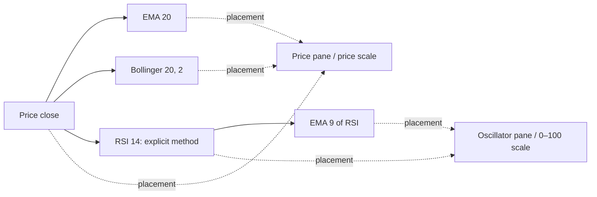

# Indicator inventory, overlays and chart composition

Research date: 2026-10-20. Rust baseline: `6150b4f` on `personal/main`.
TC2000 installed build: `25.0.9511.21172`.

## What the original chart report omitted

The original report identified indicator editing and pane movement, but did not
inventory the indicators or specify how calculation inputs, plotted outputs,
pane placement and scale sharing interact. This supplement fills that design
gap with a bounded catalog, installed-artifact evidence, actual Rust registry
execution and detailed EMA/Bollinger/RSI/MACD analysis.

This is an inventory and architecture investigation, not a completed numerical
parity certification. Core families below received detailed analysis; the
catalog table records candidate matches and remaining checks for every entry.

## Inventory boundaries and deliverables

| Inventory | Result | What it establishes |
|---|---:|---|
| [Official technical chapter](https://help.tc2000.com/m/69404/c/213565) | 64 articles | All chapter links: 63 indicator/plot references and one background article; some articles describe several studies |
| Installed Charting calculator candidates confirmed by REA | 116 types | Exact declarations matching the bounded `calc*` candidate search; includes 2 abstract helpers, options, price/volume, formula wrappers and other support plots |
| Actual Rust registry | 151 definitions | 51 price overlays and 100 subpane definitions, producing 255 default outputs in the synthetic-bar probe |
| Rust multiple-instance support | 24 definitions | Other 127 definitions replace the existing instance of that code rather than allowing independent parameter variants |

These counts are not interchangeable. We have not observed the complete installed
TC2000 picker under this account's entitlements. The official chapter excludes
separate fundamentals, Worden T2 breadth, PCF examples, saved user indicators and
some shipped calculator types. Dynamic reflection, non-`calc*` names and
obfuscated names can escape the binary candidate search.

Reference files:

- [Official catalog and Rust candidates](tc2000-indicator-catalog.json): all 64 titles/URLs, candidate codes, review notes and explicit unvalidated parity status.
- [Installed calculator declarations](tc2000-indicator-types.json): 116 matched types with tokens, declared settings and Evidence IDs.
- [Full Rust registry table](terminal-rs-indicators.md): all 151 definitions, parameters/defaults/ranges, placement, repeatability, output styles and observed warmups.
- [Rust probe and detailed inventory](terminal-rs-indicators.json): aliases, ranges/reference levels, outputs, source locations and reproducible gap-probe results.

The Rust inventory came from a scratch executable calling the real public
`registry::all()` and `Def::run()`, outside the repository. It used 3,000 finite
synthetic daily bars. Warmup indexes are observations for that input and default
settings, not universal minimum-history guarantees. No full app was launched.

## Three independent relationships

| Relationship | Example | What changes |
|---|---|---|
| Calculation input | EMA9 of RSI14, rather than EMA9 of close | Numerical values and dependency graph |
| Pane placement | Put RSI and volume in one pane | Screen location; not the values |
| Scale membership | Put EMA20 and close on the same price axis | Value-to-pixel mapping; not the calculation input |

TC2000's [source-selection workflow](https://help.tc2000.com/m/69401/l/325646-how-to-change-the-data-source-for-an-indicator)
demonstrates Stochastics calculated from OBV. Its [drag-overlay workflow](https://help.tc2000.com/m/69401/l/1687596-how-to-drag-drop-indicators-to-overlay-on-a-plot)
initially keeps separate scales. The [overlay instructions](https://help.tc2000.com/m/33346/l/335250-how-to-overlay-an-indicator)
describe a separate option to share an axis. Co-location therefore cannot be
implemented as an automatic change of calculation source or units.

For the requested price/EMA/Bollinger/RSI setup, the intended model is:

Solid arrows are computations; dotted arrows are display assignments.
RSI should ordinarily occupy its own bounded scale. Overlaying it on the price
pane should keep an independent oscillator axis unless the user explicitly
selects a compatible scale arrangement. Two curves meeting in pixels on
independent axes does not establish a numerical crossover.

### Installed-artifact corroboration

All following statements describe static calls, not observed UI execution:

1. `AddIndicatorDialogNew.ItemClicked` calls `WebChart.AddIndicatorClicked`.
   The latter clones defaults, reads `DefaultAddMode`, and contains chooser,
   child-plot and add-plot paths. `AddPlot` creates line/channel/two-line plots,
   assigns panes/scales and invokes `AfterNewlyAdded` (A).
2. `PlotBase.DataSource` resolves its source provider; `SourcePlot` resolves
   `OutputDataWrapper.OwnerPlot`. Source changes subscribe to data-change
   events, trigger calculation and invalidate the chart. `LinePlot.Calculate`
   reads provider data, calls `ILineCalc.Calculate`, then publishes output (A/B).
3. The source chooser enumerates panes/scales/plots and child plots. Its handlers
   select line providers or channel top/bottom providers and call `setSource`
   (B/D). This confirms multi-output source selection infrastructure; it does
   not establish every legal combination or exposure of a channel's center.
4. RSI's post-add method calls `LinePlot.DataProv` and
   `calcMovingAverage.AddChildAvg`. That helper constructs a moving average,
   creates a line, initializes it and adds it to a scale (C). It supports an
   RSI-to-MA composition path; exact default arguments remain unverified.
5. Pane/scale moving and combining update scale-layer membership and
   `ScaleWith`, separately from the calculation-source field (A/B/E).

The reflector scans executing-assembly types and creatable attributes before
populating calculator dictionaries (F). Picker/scannable discovery also
consults indicator permission checks (A). An installed class is therefore not
proof that a particular account sees it in the picker.

## Detailed families and compatibility

### Moving averages, including EMA

[TC2000 documents](https://help.tc2000.com/m/69404/l/747056-moving-average)
simple, exponential, front-weighted and Hull averaging, alternative price
components and displaced plots. Its formula API accepts numeric inputs.

Rust exposes SMA/EMA/WMA/HMA plus many additional families. Chart EMA currently
takes close only: `registry.rs:446` passes `Input::c()`, despite other OHLC
helpers existing. EMA uses alpha `2/(n+1)` and starts from the mean of its first
n finite samples (`ma.rs:16`, `:42`); EMA20 first appears at index19 without gaps.

Missing chart controls include source field/output selection, generic input
chaining, visual displacement, per-instance style and optional start markers.
EMA20 and EMA50 can coexist, but identical specs toggle off. TC initialization
and history depth remain unknown, so equal periods alone do not certify parity.
Keep visual displacement separate from a historical formula/bar offset.

### Bollinger Bands, %b and bandwidth

The [TC reference](https://help.tc2000.com/m/69404/l/744931-bollinger-bands)
allows several center-average types. Dispersion uses a population divisor and
arithmetic-mean variance even when the center uses another method. A different
center type must not silently select a weighted-variance formula.

Rust BB uses SMA(close) plus/minus a configurable population-standard-deviation
multiple (`volatility.rs:47`). Its three outputs are Upper/Basis/Lower lines;
default20/2 starts at index19. There is no configurable center/source or band-fill
setting, and a second BB parameter set replaces the first.

[Bandwidth's documented formula](https://help.tc2000.com/m/69404/l/744935-bollinger-bandwidth)
is a ratio; Rust `BBW` multiplies it by100 (`volatility.rs:59`). This affects
thresholds and axis labels. `PCTB` is a separate relative-position output, not
a deviation multiple. Division-by-zero, missing values and alternate centers
still need matched fixtures.

### Plain RSI versus Wilder RSI

[TC2000 distinguishes](https://help.tc2000.com/m/69404/l/747071-rsi-wilder-s-rsi)
rolling-average gains/losses RSI from Wilder-smoothed RSI. Plain RSI's formula
also permits an additional SMA of its output.

Rust's sole `RSI` entry computes the Wilder version (`momentum.rs:12`,
`registry.rs:579`): seed n close changes, then smooth gains/losses with
alpha1/n. First defined index is n; default14 uses range0..100 and levels30/70.
Flat input returns50; rising input with no losses returns100. Those edge choices
have not been verified against TC2000.

A generic chart-source graph must support an MA of the selected RSI output,
without confusing that child smoothing with RSI's internal method. Multiple
RSI configurations and editable reference levels are also missing.

### MACD and histogram

Rust `MACD` emits a line, signal and histogram from one definition
(`registry.rs:583`). Its component and signal EMAs use SMA seeds
(`momentum.rs:49`, `:62`, `:78`); default12/26/9 defines the line at index25
and signal/histogram at33. The pane includes zero in its automatic scale.

TC has separate MACD/histogram calculator declarations, and documented shared
display examples. We must map selected outputs and smoothing choices explicitly,
rather than treating one saved indicator name as equivalent to Rust's composite
definition. Numerical defaults, seed history and all parameter combinations
remain unvalidated.

### Other naming and unit hazards

- [ATR](https://help.tc2000.com/m/69404/l/744766-average-true-range-atr):
  the TC formula defaults to simple averaging; Rust uses Wilder RMA
  (`volatility.rs:21`). A smoothing-method setting is required for compatibility.
- [Worden BOP](https://help.tc2000.com/m/69404/l/744980-balance-of-power-bop)
  is a distinct Worden study. Rust computes an SMA of
  `(close-open)/(high-low)` (`momentum.rs:356`). Its label does not prove
  equivalence to Worden's BOP.
- [TSV](https://help.tc2000.com/m/69404/l/747088-time-segmented-volume)
  supports smoothed compositions in TC. Rust sums close changes times volume
  (`volume.rs:312`); parity with Worden's study remains unproven.
- Session-reset VWAP, rolling volume-weighted averages, relative-strength ratios,
  volume-at-price profiles and price-comparison overlays require separate models.
  Related names are candidate mappings, not interchangeable functions.

## All official chapter entries and Rust candidates

This table is a coverage checklist, not a formula-equivalence claim. Every
numeric parity status remains unvalidated. A dash means no dedicated match was
identified in the 151-definition registry; other app views may expose related data.

| TC2000 official reference | Rust candidate codes | Assessment / remaining work |
|---|---|---|
| [The Evolution of Balance of Power® & MoneyStream®](https://help.tc2000.com/m/69404/l/747093-the-evolution-of-balance-of-power-moneystream) | — | Background article, not an indicator. |
| [Acceleration Bands](https://help.tc2000.com/m/69404/l/744688-acceleration-bands) | `ACCBANDS` | Candidate family; equation/settings parity untested. |
| [Directional Movement +DI -DI ADX](https://help.tc2000.com/m/69404/l/744697-directional-movement-di-di-adx) | `DMI`, `ADX`, `ADXR` | Smoothing and DI/ADX period relationships need matching. |
| [Aroon & Aroon Oscillator](https://help.tc2000.com/m/69404/l/744755-aroon-aroon-oscillator) | `AROON`, `AROONOSC` | Candidate family; tie/window conventions untested. |
| [Average True Range (ATR)](https://help.tc2000.com/m/69404/l/744766-average-true-range-atr) | `ATR` | Method mismatch: Rust Wilder; TC formula defaults to simple. |
| [Bid/Ask/Spread Plots](https://help.tc2000.com/m/69404/l/1220382-bid-ask-spread-plots) | — | No equivalent chart study in the registry; quote UI is separate. |
| [Bollinger %b](https://help.tc2000.com/m/69404/l/744914-bollinger-b) | `PCTB` | Candidate ratio; zero-width behavior and center type need validation. |
| [Bollinger Bands®](https://help.tc2000.com/m/69404/l/744931-bollinger-bands) | `BB` | Rust close/SMA only; TC exposes more center/source choices. |
| [Bollinger Bandwidth](https://help.tc2000.com/m/69404/l/744935-bollinger-bandwidth) | `BBW` | Units differ: Rust percent; documented TC formula ratio. |
| [Balance of Power® (BOP)](https://help.tc2000.com/m/69404/l/744980-balance-of-power-bop) | `BOP` | Same name is insufficient: Worden-specific computation unverified. |
| [Chaikin Money Flow](https://help.tc2000.com/m/69404/l/745005-chaikin-money-flow) | `CMF` | Candidate family; full numeric parity untested. |
| [Commodity Channel Index](https://help.tc2000.com/m/69404/l/745020-commodity-channel-index) | `CCI` | Candidate family; source, constants and smoothing need validation. |
| [Coppock Curve](https://help.tc2000.com/m/69404/l/745024-coppock-curve) | `COPPOCK` | Candidate family; settings/smoothing parity untested. |
| [Derivative Oscillator](https://help.tc2000.com/m/69404/l/745291-derivative-oscillator) | — | No dedicated registry entry. |
| [Detrended Price Oscillator](https://help.tc2000.com/m/69404/l/745294-detrended-price-oscillator) | `DPO` | Candidate family; displacement/alignment need validation. |
| [Dollar Volume](https://help.tc2000.com/m/69404/l/745295-dollar-volume) | — | No dedicated registry entry; price/volume formula would be needed. |
| [Donchian Channels](https://help.tc2000.com/m/69404/l/745298-donchian-channels) | `DONCHIAN` | Candidate family; include-current-bar policy untested. |
| [Ease of Movement](https://help.tc2000.com/m/69404/l/745315-ease-of-movement) | `EOM` | Candidate family; scaling/smoothing parity untested. |
| [Elder Ray Bull & Bear Power](https://help.tc2000.com/m/69404/l/745402-elder-ray-bull-bear-power) | `ELDER` | Bull/bear outputs exist; formula parity untested. |
| [Elder Force Index](https://help.tc2000.com/m/69404/l/745449-elder-force-index) | `EFI` | Candidate family; period and smoothing parity untested. |
| [Elliott Wave Oscillator](https://help.tc2000.com/m/69404/l/745461-elliott-wave-oscillator) | — | No dedicated entry; AO/MACD are related, not verified replacements. |
| [Envelope Channels](https://help.tc2000.com/m/69404/l/745462-envelope-channels) | `ENV` | Rust SMA source fixed; TC source/average choices broader. |
| [Fisher Transform](https://help.tc2000.com/m/69404/l/756132-fisher-transform) | `FISHER` | Candidate family; transform/clipping conventions untested. |
| [Ichimoku](https://help.tc2000.com/m/69404/l/745488-ichimoku) | `ICHIMOKU` | Candidate family; displaced outputs need explicit time mapping. |
| [Kaufman Efficiency Ratio](https://help.tc2000.com/m/69404/l/749623-kaufman-efficiency-ratio) | `ER` | Candidate family; zero-denominator convention untested. |
| [Keltner Channels](https://help.tc2000.com/m/69404/l/745498-keltner-channels) | `KC` | Candidate family; ATR method/source/settings need validation. |
| [Klinger Volume Oscillator and Histogram](https://help.tc2000.com/m/69404/l/745499-klinger-volume-oscillator-and-histogram) | `KVO` | Line/signal/histogram need individual output mapping. |
| [Linear Regression Line & Moving Linear Regression](https://help.tc2000.com/m/69404/l/745911-linear-regression-line-moving-linear-regression) | `LSMA`, `SLOPE`, `SEB` | Related regression studies; not complete line/channel equivalence. |
| [Mass Index](https://help.tc2000.com/m/69404/l/751728-mass-index) | `MASS` | Candidate family; smoothing/history parity untested. |
| [MACD & MACD Histogram](https://help.tc2000.com/m/69404/l/745913-macd-macd-histogram) | `MACD` | One Rust spec emits line/signal/hist; MA method and seeds need validation. |
| [Momentum](https://help.tc2000.com/m/69404/l/745915-momentum) | `MOM` | Candidate family; absolute-vs-percent conventions matter. |
| [Money Flow Index](https://help.tc2000.com/m/69404/l/747053-money-flow-index) | `MFI` | Candidate family; ties/zero-flow handling untested. |
| [MoneyStream®](https://help.tc2000.com/m/69404/l/747055-moneystream) | — | No dedicated registry entry; Worden-specific formula unresolved. |
| [Moving Average](https://help.tc2000.com/m/69404/l/747056-moving-average) | `SMA`, `EMA`, `WMA`, `HMA` | MA families exist; selectable source, plot offset and child studies missing. |
| [On Balance Volume](https://help.tc2000.com/m/69404/l/747711-on-balance-volume) | `OBV` | Candidate family; initialization/flat-close behavior untested. |
| [Parabolic SAR](https://help.tc2000.com/m/69404/l/754974-parabolic-sar) | `PSAR` | Candidate family; initialization and reversal rules untested. |
| [Percent Volume Oscillator (PVO)](https://help.tc2000.com/m/69404/l/755038-percent-volume-oscillator-pvo) | `PVO` | Candidate family; average methods and output mapping untested. |
| [Pivot Points](https://help.tc2000.com/m/69404/l/745284-pivot-points) | `PIVOT`, `PIVOTFIB`, `PIVOTCAM`, `PIVOTWOODIE`, `PIVOTDM` | Candidate variants; session boundaries need validation. |
| [Positive Volume Index & Negative Volume Index](https://help.tc2000.com/m/69404/l/747083-positive-volume-index-negative-volume-index) | `PVI`, `NVI` | Candidate families; seeds/unchanged-volume behavior untested. |
| [Price Percent Oscillator & Histogram](https://help.tc2000.com/m/69404/l/747180-price-percent-oscillator-histogram) | `PPO` | Line/signal/hist outputs exist; period and unit parity untested. |
| [Price/Volume Trend](https://help.tc2000.com/m/69404/l/747913-price-volume-trend) | `PVT` | Candidate family; seed and denominator behavior untested. |
| [Price Zone Oscillator](https://help.tc2000.com/m/69404/l/1220413-price-zone-oscillator) | — | No dedicated registry entry. |
| [Rate of Change & Rate of Change Percent](https://help.tc2000.com/m/69404/l/755004-rate-of-change-rate-of-change-percent) | `ROC`, `MOM` | Rust ROC percent and MOM difference; explicit absolute/percent mapping needed. |
| [Relative Strength](https://help.tc2000.com/m/69404/l/747853-relative-strength) | — | Comparison-price overlay exists elsewhere; not a dedicated relative-strength ratio study. |
| [RSI & Wilder's RSI](https://help.tc2000.com/m/69404/l/747071-rsi-wilder-s-rsi) | `RSI` | Rust is Wilder only; plain RSI absent and multiple instances restricted. |
| [SMI Ergodic Indicator and Oscillator](https://help.tc2000.com/m/69404/l/1220419-smi-ergodic-indicator-and-oscillator) | `SMIERGO` | Candidate family; inspect oscillator/signal/hist outputs before mapping. |
| [Stochastic Oscillator](https://help.tc2000.com/m/69404/l/747102-stochastic-oscillator) | `STOCH` | Candidate family; K/D smoothing methods and source graph need validation. |
| [Time Segmented Volume®](https://help.tc2000.com/m/69404/l/747088-time-segmented-volume) | `TSV` | Rust delta-close*volume sum; Worden formula parity unverified. |
| [Time Series Forecast](https://help.tc2000.com/m/69404/l/749805-time-series-forecast) | `TSF` | Candidate family; forecast horizon/alignment untested. |
| [TRIX](https://help.tc2000.com/m/69404/l/747736-trix) | `TRIX` | Candidate family; percent scaling and signal parity untested. |
| [True Strength Index](https://help.tc2000.com/m/69404/l/750619-true-strength-index) | `TSI` | Candidate family; smoothing order/seed parity untested. |
| [Ultimate Oscillator](https://help.tc2000.com/m/69404/l/1220427-ultimate-oscillator) | `UO` | Candidate family; period/weight and zero-range behavior untested. |
| [Volatility Stop](https://help.tc2000.com/m/69404/l/1575824-volatility-stop) | `VSTOP` | Candidate family; ATR smoothing/reversal rules untested. |
| [Volume](https://help.tc2000.com/m/69404/l/1220430-volume) | — | Built-in chart volume display, outside the indicator registry. |
| [Volume Surge](https://help.tc2000.com/m/69404/l/1748470-volume-surge) | `RVOL` | Related relative-volume study; normalization/window parity unverified. |
| [Volume at Price](https://help.tc2000.com/m/69404/l/747119-volume-at-price) | — | No dedicated volume-at-price/profile study in the registry. |
| [Volume Rate of Change/Rate of Change Percent](https://help.tc2000.com/m/69404/l/1220433-volume-rate-of-change-rate-of-change-percent) | `VROC` | Percent variant present; absolute volume change needs explicit mapping. |
| [Volume Zone Oscillator](https://help.tc2000.com/m/69404/l/1220440-volume-zone-oscillator) | `VZO` | Candidate family; smoothing and normalization untested. |
| [Vortex Indicator](https://help.tc2000.com/m/69404/l/1220442-vortex-indicator) | `VORTEX` | Candidate family; source/window parity untested. |
| [VWAP & Moving VWAP](https://help.tc2000.com/m/69404/l/747794-vwap-moving-vwap) | `VWAP`, `VWMA` | Session VWAP and related rolling VWMA; reset/source semantics need validation. |
| [Williams Alligator](https://help.tc2000.com/m/69404/l/747130-williams-alligator) | `ALLIGATOR` | Candidate family; smoothing and forward offsets need validation. |
| [Williams Accumulation/Distribution](https://help.tc2000.com/m/69404/l/750284-williams-accumulation-distribution) | `WAD` | Candidate family; tie/seed handling untested. |
| [William's %R](https://help.tc2000.com/m/69404/l/750281-william-s-r) | `WILLR` | Candidate family; range and zero-width behavior untested. |
| [Worden Stochastics](https://help.tc2000.com/m/69404/l/747714-worden-stochastics) | — | No dedicated Worden Stochastics entry; STOCH is not a verified substitute. |

The shipped-type JSON additionally records option Greeks/value plots, PCF
wrappers, custom indexes, scan-count/forecast plots, SeasonCast, relative pattern,
Stochastic RSI/MACD, channels and support types absent from that chapter index.
Each is a declaration candidate; entitlement, backend data and exact semantics
need separate verification.

## Current chart architecture constraints

Source locations are repository-relative, verified against the research baseline.

| Layer | Existing implementation | Required extension |
|---|---|---|
| Specification | `registry.rs:241`: code and numeric parameters only | Stable instance ID, source reference, output selection, method/offset settings |
| Calculation | `worker.rs:469`: each spec independently reads the same bars | Dependency ordering, invalidation and explicit multi-output ports |
| Placement | `registry.rs:122`: fixed pane boolean | Independent pane ID, reorder/resize and overlay choices |
| Scale | Price overlays share price; oscillator outputs share their definition's linear scale | Independent scale IDs, units, bounded/log/manual policies |
| Appearance | Registry plot/tone; worker maps palette by position | Persisted line/fill/histogram visibility, color, width and style |
| Instances | 24 multi; 127 single per code | Multiple BB/RSI/MACD configurations without replacement |
| Persistence | Spec labels plus workspace chart settings | Versioned graph/pane/scale/template schema and migration |
| History | Recompute over currently loaded prefix | Defined warmup/history requirements; stable cache/invalidation policy |

Only six oscillator panes render (`chart_view.rs:35`, `:648`, `:825`).
Extra specs remain computed and saved, with a hidden-pane notice. Current subpane
heights are automatic. Price overlays participate in autoscale
(`chart/src/scene.rs:135`); oscillator panes are linear
(`:275`). Putting arbitrary RSI values on the existing price overlay path would
distort price scaling instead of supplying a proper independent axis.

Output arrays align to bars, but displaced studies such as Ichimoku extend
beyond the input length. A source port must carry timestamp/index mapping.
Its last vector entry cannot universally mean the current bar. Renderer f32/LOD
buffers and rounded legend values are inappropriate numeric-parity references.

### Reproduced missing-value risks

The scratch probe called the current Rust functions on
`[1,2,3,NaN,5,6,7,8]`:

- EMA3 blanks the missing index and resumes using its retained state.
- RSI3 returns100 at the missing index, treating the non-finite difference as
  zero gains/losses through floating-point max operations.
- MACD2/3/2 has a defined line at index2, then remains undefined after the gap;
  its private streaming EMA accumulator becomes non-finite.

Exact results are in the Rust JSON inventory. These are Rust observations, not
TC observations. General source chaining would expose such gaps routinely during
warmup, making validity handling a prerequisite. Paging more historical bars can
also alter recursive seeds and already-visible values.

## Revised first implementation milestone

The earlier editor-and-pane proposal needs a source/placement/scale model first.
Recommended branch: `codex/chart-indicator-model` from `personal/main`.

1. Define independent `IndicatorInstance`, `SourceRef`, `OutputPort`,
   `PaneId` and `ScaleId`. Source choices initially cover OHLCV fields and
   another instance's named scalar output. Preserve multi-output identity.
2. Keep pure calculations separate from placement and style. Evaluate a validated
   acyclic graph, reject cycles and dangling ports, and invalidate downstream
   outputs after source/parameter changes. Cycle policy is our design choice,
   not a recovered TC implementation.
3. Make units, undefined values, warmup and plot displacement explicit. Fix the
   observed gap handling before allowing arbitrary indicator outputs as inputs.
   Provide versioned RSI/ATR methods and BBW units without silently reinterpreting
   saved layouts or scanner thresholds.
4. Build the picker/editor around that model: Add to price, Add to new pane,
   Overlay in existing pane, Scale with, and Calculation source are distinct
   controls. Support multiple instances, independent styles and pane dividers.
5. Migrate existing specs to their current close source, placement and calculation
   semantics; preserve unknown codes and provide deterministic stable IDs.

The first acceptance chart should contain close plus EMA20, EMA50 and BB20/2 on
the price scale; RSI14 with EMA9(RSI14) in a bounded pane; and MACD with its
histogram. A second case overlays volume and RSI in one pane with separate axes,
proving that pane movement cannot change computations or force incompatible
scales. Also test two different BB configurations simultaneously.

Further acceptance checks: BB on a selected non-price output; changing RSI period
updates only descendants; removing a source has an explicit dependent-removal
policy; plot offsets cannot introduce lookahead; different timeframe/session data
aligns by timestamp; hidden plots remain usable as inputs; save/load and templates
preserve all relationships. These are proposed behaviors, not existing features.

## Evidence ledger and unresolved work

Charting SHA-256:
`e37d5f30ca71ec0ba8cba4c207b07058d93b729749dde5df41daf43fc8148d7c`.

| Ref | REA Evidence ID | Scope |
|---|---|---|
| A | `ev_b8470f0fd2ab706cfda0b2418cb924283fcb734e0b73fecc1bc51df0366ce946` | Add/picker, WebChart and LinePlot |
| B | `ev_65e97e80a8201b7664c47af9fdcefa7bc366cc35235073bcefd5d198fab63bb3` | PlotBase, source/edit and scale/pane operations |
| C | `ev_7c217d50c799ada5bd022627bab342ef4e802b29d60128fac70d2047d01d5602` | Moving average, Bollinger, RSI and Wilder RSI |
| D | `ev_92b0c4b14740405b67933eecc13ded34bb20e412069692df6ce66b218579634d` | Source chooser, channel providers and dataset contracts |
| E | `ev_af008cc9b89af17b0398e123e59b66eb461f453a6500c21a2b92dfb19d18be1e` | Pane/ScaleLayer |
| F | `ev_92094b7cbee90f9fda1d332fe99e852c0221c20cc081ad713e51ebe2ad15391e` | XMLReflector registration/discovery |
| G1 | `ev_0db41f7689d257c342a17848e2fff8ce25015e51cfd16edae537b1a3b79feed6` | Calculator inventory batch1 |
| G2 | `ev_45c5f13c0d78227c22fa1b4cd0f0f1b2c037580ea7b5c99e1e80da9668573ceb` | Calculator inventory batch2 |
| G3 | `ev_bb679934a9d16468461eb52019a24009490cc0c6cc9fac50523f215071486a88` | Calculator inventory batch3 |
| G4 | `ev_f9960e65066b9682803a60b0baf6ce9c4697cf604cf1ea680612a53ffb753613` | Calculator inventory batch4 |
| G5 | `ev_50188ab913cf79ea4bcebd9bbe9daf53923e286104c338f58a03e18983a9e26a` | Calculator inventory batch5 |

The two unmatched candidates `calcAverage` and `calcStdDev` are not evidence of
absent features; they may be method names or declarations outside this exact
namespace selection. The JSON retains this distinction.

REA metadata coverage remains partial, with unresolved/obfuscated calls and no
recovered MVID. Static calls cannot prove runtime branch values. Official web
documentation may describe another release. The earlier black TC2000 capture
prevents claiming direct visual verification. No target execution was added.

The portable REA bundle remains outside Git in the session's `tc2000-analysis`
scratch directory as `indicator-inventory-evidence.json` (115 records,
201,803,198 bytes). It includes the inventory and composition Evidence above.

| Question | Status |
|---|---|
| Complete official technical-chapter link inventory | Answered within that chapter |
| Actual Rust registry, defaults, outputs and placement | Answered for baseline/default probe |
| Installed calculator candidates and declared setters | Answered within bounded search; not a complete picker inventory |
| Source/placement/scale separation | Corroborated by official workflows and static calls |
| EMA/BB/RSI/MACD Rust calculation semantics | Answered; TC seed/edge parity remains partial |
| Every TC study's formula, defaults and supported inputs | Unresolved beyond the detailed families and structural inventory |
| Entitled picker contents, gestures and all legal compositions | Unresolved; requires usable UI/runtime observation |
| Numeric equivalence | Unvalidated; requires equal bars, adjustment/session/history and exported f64 fixtures |

Before claiming parity for a family, compare matched OHLCV fixtures with the same
session, adjustments and warmup. Include flat/up/down/gapped/short histories,
zero volume/width, offsets and multi-output selection. The inventory is useful
for scoping implementation; it must not be presented as proof that all studies
already behave identically.

This pass changed documentation only and ran the external registry/probe
executable. It did not change application code, rerun the full workspace suite,
commit or push.

## Subsequent implementation checkpoint

The first increment is implemented on `codex/chart-indicator-model`. It adds
stable instances, selected scalar sources and output chaining, chart-local
parameter/color/visibility controls, pane grouping/resizing, shared/independent/
fixed scales, and v2 layout persistence with legacy import. RSI/MACD gap handling
is corrected. See [Chart studies](../chart-studies.md) for usage and remaining
limits; the inventory and probes above remain the historical baseline.

Validation: 326 workspace tests passed, 5 network tests ignored; formatting and
strict workspace/all-target Clippy passed in WSL. The Vulkan sample app rendered
EMA/Bollinger overlays, RSI with EMA(RSI), and MACD using an isolated data folder;
the saved v2 layout retained six studies. A headless pointer-event regression
test verifies pane resizing without panning. No commit or push was performed.
